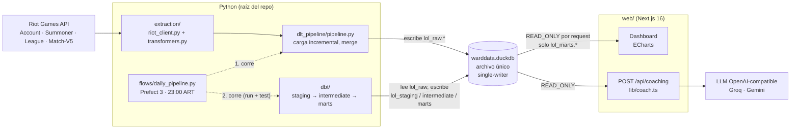
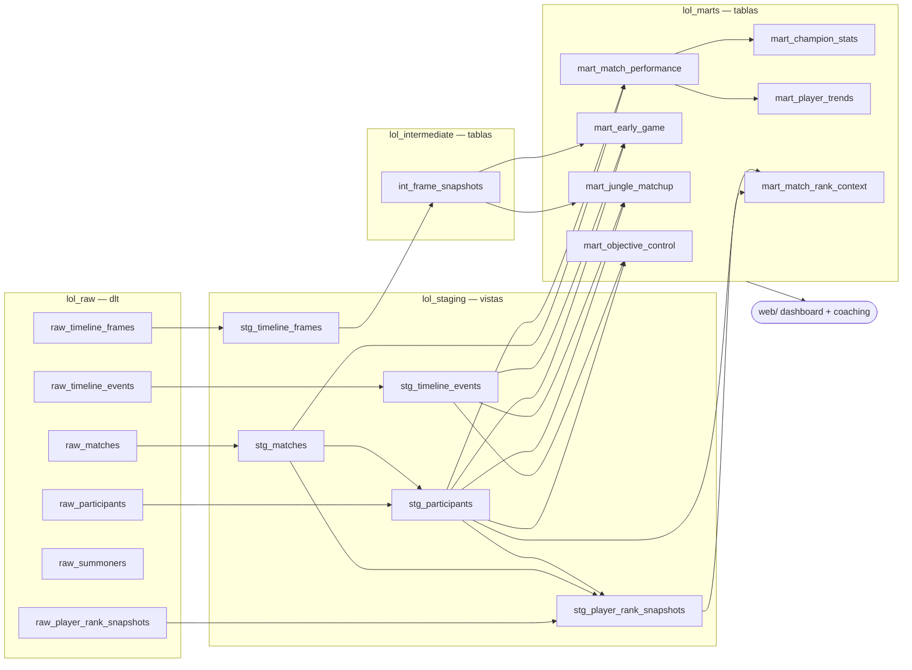
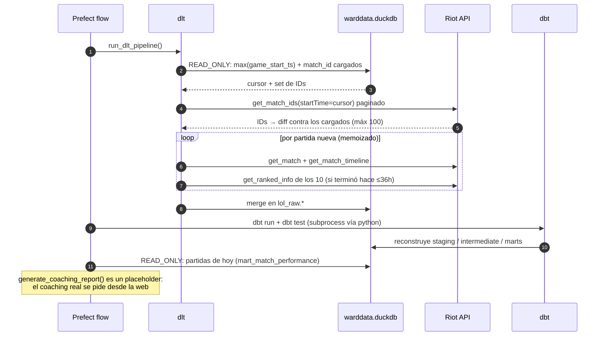

# ward-eye — diagramas

GitHub y VS Code (con la extensión de Mermaid) renderizan estos bloques directo.

## 1. Arquitectura general

## 2. Linaje de datos (dlt → dbt → web)

> `raw_summoners` no lo consume ningún modelo de dbt: dlt lo refresca en cada
> corrida y queda como dato de referencia.

## 3. Una corrida diaria, paso a paso

